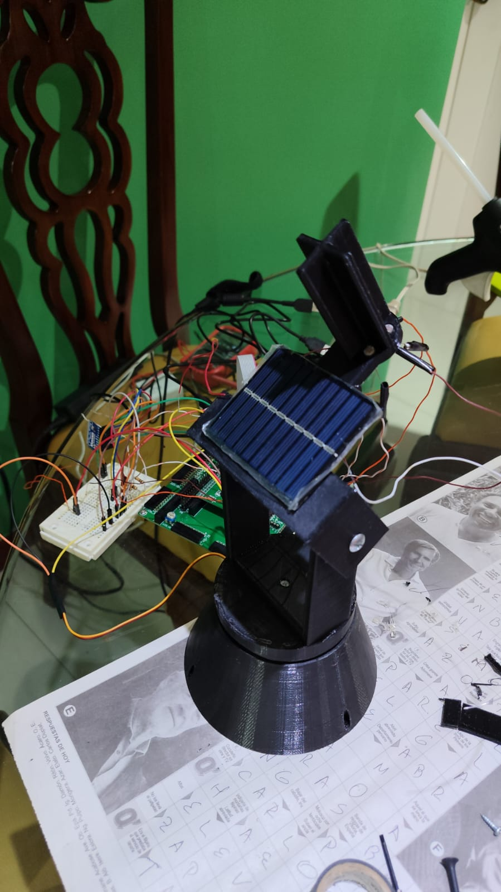
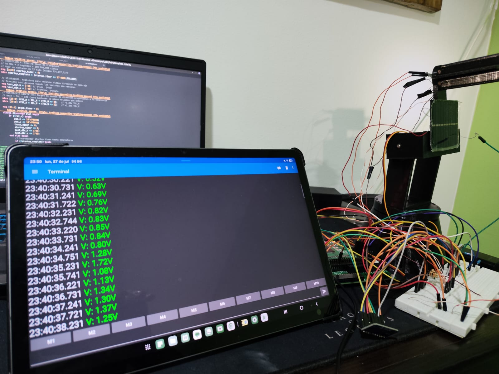
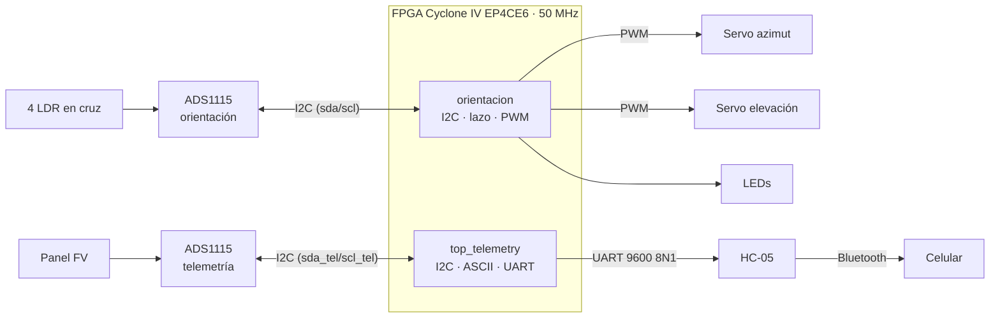

# Seguidor solar de dos ejes con telemetría sobre FPGA


Proyecto final de **Electrónica Digital 1** — Programa de Ingeniería Eléctrica, Facultad de
Ingeniería, Universidad Nacional de Colombia, Bogotá D.C.

<p align="center">
  
  
</p>

## Resumen

Seguidor solar (*solar tracker*) de dos ejes implementado **íntegramente en una FPGA Intel/Altera
Cyclone IV EP4CE6**, sin microcontrolador:

- **Captura:** cuatro fotorresistencias (LDR) en cruz con tabiques de sombreado.
- **Medición:** dos ADC ADS1115 de 16 bits por I2C, uno para los LDR y otro para la tensión del panel.
- **Actuación:** dos servomotores (azimut y elevación) con PWM generado en la lógica programable.
- **Telemetría:** la tensión del panel se envía por UART a un módulo Bluetooth HC-05 y se lee en el
  celular cada 500 ms.

Todos los bloques (maestro I2C, controlador de orientación, PWM y UART) se describieron como máquinas
de estados en Verilog y se verificaron por simulación antes de la síntesis. En la prueba final, la
tensión del panel **sube** mientras el sistema se alinea con la luz y **baja** al desalinearlo a mano.

## Objetivos

**General:** diseñar, implementar y validar experimentalmente un seguidor solar de dos ejes
controlado íntegramente desde una FPGA Cyclone IV EP4CE6, con telemetría inalámbrica de la tensión
generada por el panel.

**Específicos:**

1. Diseñar el arreglo de cuatro LDR en cruz y su acondicionamiento para obtener el error de
   orientación en dos ejes por lectura diferencial.
2. Describir en HDL un maestro I2C que configure y lea el ADS1115 (start, stop y ACK).
3. Implementar un generador PWM parametrizable para posicionar dos servos entre 0° y 180°.
4. Describir un transmisor UART y su generador de baudios para enviar la telemetría al HC-05.
5. Verificar por simulación cada bloque antes de la síntesis y validar el sistema integrado.
6. Validar con la telemetría que la orientación activa aumenta la tensión del panel frente a una
   posición desalineada.

## Arquitectura



| Bloque | Módulos | Puntos clave |
|--------|---------|--------------|
| Adquisición I2C | `i2c_master`, `ads1115_reader` | 100 kHz con SCL de 4 fases, open-drain, resolución de 125 µV. |
| Orientación | `orientacion` | Lectura diferencial, tolerancias adaptativas, histéresis direccional, arranque de 2 s. |
| PWM | dentro de `orientacion` | Periodo de 20 ms, pulsos de 1–2 ms, pasos de 250 ciclos (≈ 0.9°). |
| Telemetría | `top_telemetry`, `bin_to_ascii`, `uart_tx` | Trama ASCII `V: x.xxV\r\n` cada 500 ms a 9 600 baudios. |

Detalle completo, ecuaciones y máquinas de estados: **[docs/arquitectura.md](docs/arquitectura.md)**.

## Hardware

FPGA Cyclone IV EP4CE6 (tarjeta Core, 50 MHz), 2 × ADS1115, 4 LDR, 2 servomotores, módulo HC-05,
panel fotovoltaico y chasis impreso en 3D en PLA. Materiales, esquemático, asignación de pines y
diseño mecánico: **[hardware/README.md](hardware/README.md)**.

## Cómo compilar y simular

Todo el proyecto de Quartus está en [`src/`](src/): los módulos Verilog, el banco de pruebas,
`top.qpf`, `top.qsf`, `top.sdc` y el `Makefile` del curso. Detalles en [src/README.md](src/README.md).

**Con Quartus Prime Lite (Windows o Linux):**

1. Abrir `src/top.qpf` en Quartus.
2. Compilar (*Processing → Start Compilation*). Los resultados quedan en `src/build/`.
3. Programar la tarjeta con *Tools → Programmer* (USB-Blaster) usando `build/top.sof`.

**Con el flujo del curso (Linux, Makefile):** desde `src/`:

```bash
make sim     # simulación con Icarus Verilog; en consola debe salir  V: 4.85V
make rtl     # diagrama RTL con Yosys
make syn     # síntesis con Quartus
make config  # programar la FPGA
```

> `make sim` genera un archivo de ondas de unos 8.7 GB. Ver
> [src/NOTAS_PUESTA_EN_MARCHA.md](src/NOTAS_PUESTA_EN_MARCHA.md) para limitarlo.

**Telemetría:** emparejar el celular con el HC-05 y abrir cualquier terminal serial Bluetooth (perfil
SPP). Llega una línea `V: x.xxV` cada 500 ms.

## Resultados

| Parámetro verificado en simulación | Esperado | Resultado |
|------------------------------------|----------|-----------|
| Frecuencia de SCL | 100 kHz | Correcto |
| ACK del ADS1115 | Nivel bajo en el bit 9 | Correcto |
| Periodo PWM | 20 ms | Correcto |
| Ancho de pulso | 1.0 a 2.0 ms | Correcto |
| Velocidad UART | 9 600 bps (+0.0064 %) | Correcto |
| Longitud de la trama | 10 caracteres ASCII | Correcto |
| Refresco de telemetría | 500 ms | Correcto |
| Convivencia de los dos buses | Sin interferencia | Correcto |

En el prototipo, el sistema orienta ambos ejes hacia la fuente de luz, no oscila en el equilibrio y la
tensión mostrada en la tablet sube al alinearse y cae al desalinearlo. **Limitaciones:** no se
registró una jornada completa y se mide tensión, no potencia, así que no se reporta un porcentaje de
mejora. Más en **[docs/resultados.md](docs/resultados.md)**.

## Progreso del proyecto

Las etapas del desarrollo (caracterización manual de los servos, prototipo de balso, lazo
automático, telemetría, chasis 3D, validación) y los problemas que se resolvieron están en
**[docs/progreso.md](docs/progreso.md)**. Los cambios del repositorio están en
[CHANGELOG.md](CHANGELOG.md).

## Estructura del repositorio

```
.
├── README.md
├── CHANGELOG.md
├── docs/
│   ├── informe/Informe_Final_Solar_Tracker.pdf   # informe final (28/07/2026)
│   ├── img/                                      # figuras extraídas del informe
│   ├── arquitectura.md                           # diseño de los bloques
│   ├── resultados.md                             # pruebas y conclusiones
│   └── progreso.md                               # bitácora de etapas
├── hardware/README.md                            # materiales, esquemático, pines, mecánica
└── src/                                          # proyecto de Quartus completo
    ├── top.v, orientacion.v, i2c_master.v        # seguimiento
    ├── top_telemetry.v, ads1115_reader.v,
    │   bin_to_ascii.v, uart_tx.v                 # telemetría
    ├── top_tb.v, slave_model_inc.v               # simulación
    ├── top.qpf, top.qsf, top.sdc                 # proyecto, pines y reloj
    ├── Makefile                                  # flujo del curso (sim, rtl, syn, config)
    └── NOTAS_PUESTA_EN_MARCHA.md                 # guía rápida de montaje y depuración
```

## Autores

- **Reinaldo Andrés Barbosa Contreras** — rebarbosac@unal.edu.co
- **Sebastián Menco Mier**

**Docente:** Sebastián Eslava

## Referencias

1. Texas Instruments, *ADS111x Ultra-Small, Low-Power, I2C-Compatible, 860-SPS, 16-Bit ADCs*,
   SBAS444, 2018.
2. Intel Corporation, *Cyclone IV Device Handbook*, CYIV-5V1, 2016.
3. NXP Semiconductors, *I2C-bus specification and user manual*, UM10204, Rev. 6, 2014.
4. Guangzhou HC Information Technology Co., *HC-05 Bluetooth to Serial Port Module Datasheet*, 2010.
5. J. A. Duffie y W. A. Beckman, *Solar Engineering of Thermal Processes*, 4.ª ed., Wiley, 2013.
