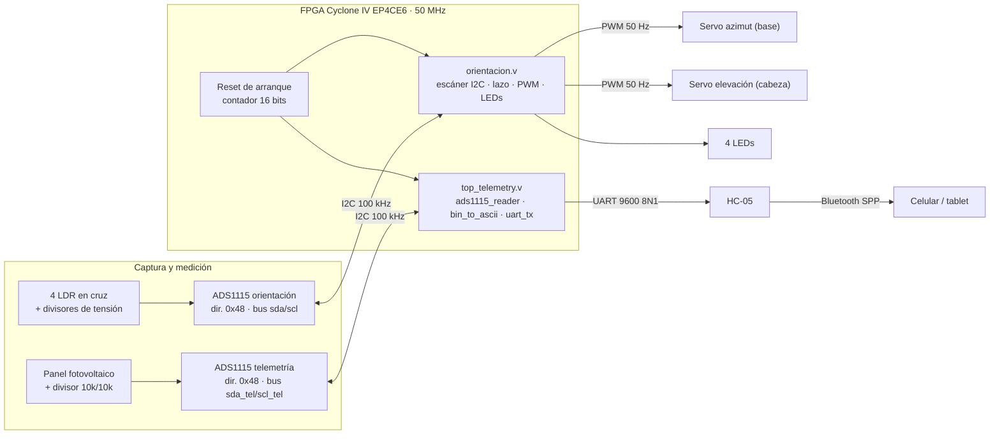
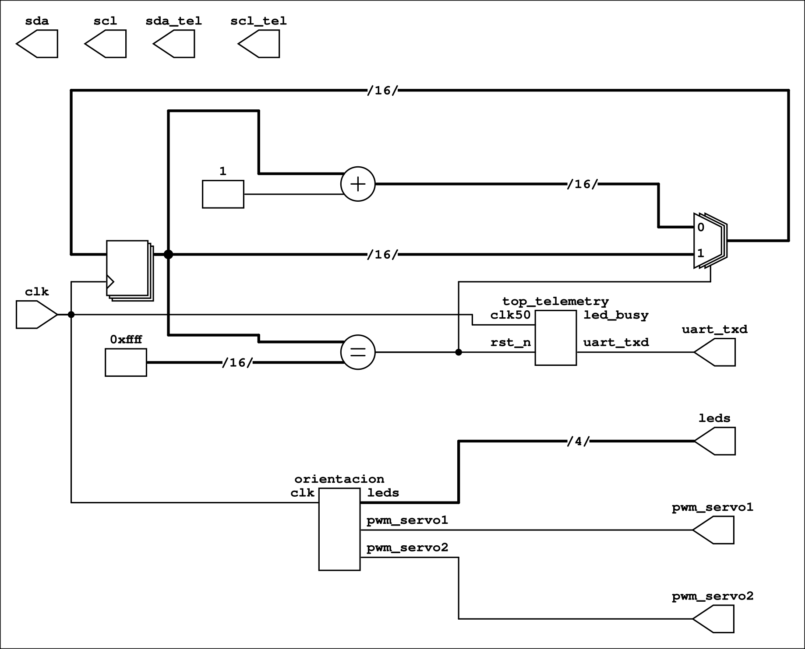
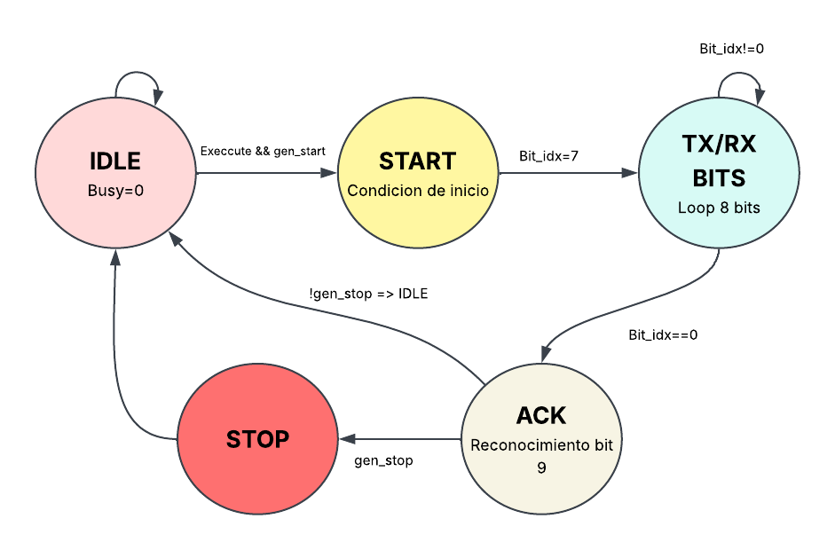
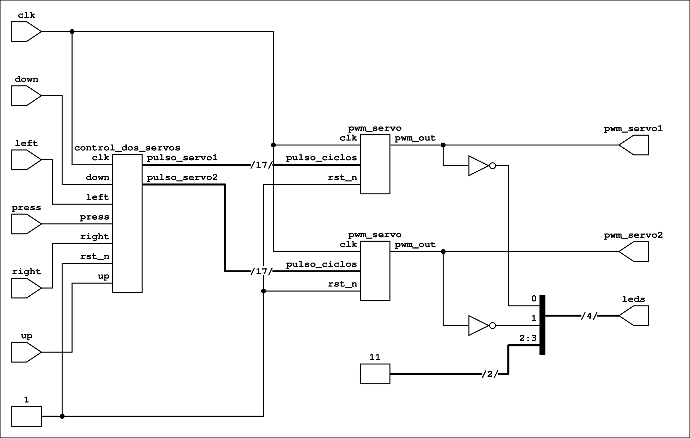
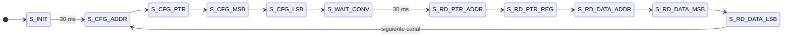
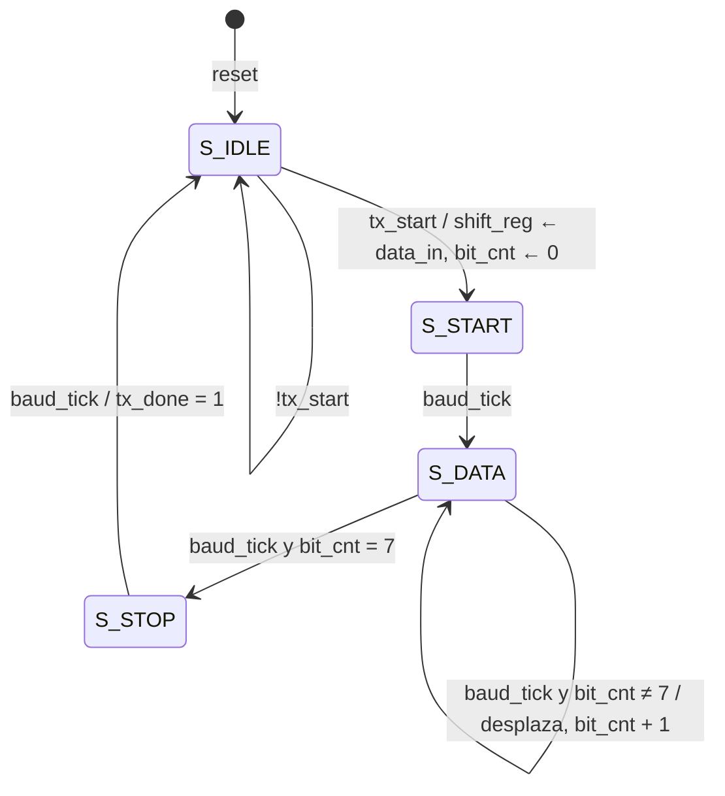
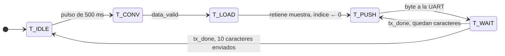

# Arquitectura y diseño de los bloques

Resumen técnico del informe final ([PDF](informe/Informe_Final_Solar_Tracker.pdf), secciones 2 y 3).

## Contenido

- [Visión general](#visión-general)
- [Jerarquía de módulos](#jerarquía-de-módulos)
- [Reset de arranque](#reset-de-arranque)
- [Bloque 1 — LDR y adquisición I2C](#bloque-1--ldr-y-adquisición-i2c)
- [Bloque 2 — Controlador de orientación](#bloque-2--controlador-de-orientación)
- [Bloque 3 — PWM para los servomotores](#bloque-3--pwm-para-los-servomotores)
- [Bloque 4 — UART hacia el HC-05](#bloque-4--uart-hacia-el-hc-05)

## Visión general

El sistema tiene cinco subsistemas alrededor de la FPGA, que es el **único** elemento de
procesamiento (no hay microcontrolador ni procesador embebido):

| Subsistema | Elemento | Función |
|------------|----------|---------|
| Captura | 4 LDR en cruz con tabiques opacos | El sombreado selectivo produce un desbalance medible que indica dirección y magnitud del error. |
| Actuadores | 2 servomotores de posición | Azimut (giro de la base, este–oeste) y elevación (inclinación del panel). |
| Medición analógica | 2 × ADS1115 (16 bits, I2C) | Uno lee los 4 LDR; el otro mide la tensión del panel. |
| Procesamiento | FPGA Cyclone IV EP4CE6 | Maestros I2C, lazo de control, PWM y UART descritos en Verilog. |
| Transmisión | HC-05 (modo esclavo, SPP) | Reenvía la trama serial al celular. |

**¿Por qué dos buses I2C?** Los dos ADS1115 tienen el pin `ADDR` a masa, es decir, la misma
dirección `0x48`, y no pueden convivir en el mismo bus. En lugar de recablear uno, se duplicó el bus:
la FPGA tiene pines de sobra y así el lazo de seguimiento y la telemetría quedan totalmente
desacoplados, sin arbitraje.

**¿Por qué FPGA y no microcontrolador?** El maestro I2C, el generador de baudios y los canales PWM no
son periféricos ya hechos sino hardware que hay que construir, y los bloques funcionan de forma
realmente concurrente: la generación de pulsos de servo no se ve afectada por la latencia del I2C ni
por la duración de la trama UART.

*Figura 3 del informe — RTL del top level (RTL Viewer de Quartus).*

## Jerarquía de módulos

| Archivo | Nivel | Función |
|---------|-------|---------|
| `top.v` | Superior | Instancia los dos subsistemas y genera el reset de arranque. |
| `orientacion.v` | Sub-nivel 1 | Lazo de seguimiento: escáner I2C de cuatro canales, lógica diferencial, PWM de ambos ejes e indicación por LED. |
| `i2c_master.v` | Sub-nivel 2 | Maestro I2C a 100 kHz orientado a byte, usado por `orientacion`. |
| `top_telemetry.v` | Sub-nivel 1 | Secuenciador de telemetría: dispara la medida, arma la trama y la entrega a la UART. |
| `ads1115_reader.v` | Sub-nivel 2 | Maestro I2C propio más el secuenciador de la transacción completa del ADS1115. |
| `bin_to_ascii.v` | Sub-nivel 2 | Conversión combinacional del código del ADC a la cadena ASCII de la trama. |
| `uart_tx.v` | Sub-nivel 2 | Transmisor UART 8N1 a 9 600 baudios. |
| `top_tb.v` | Verificación | Banco de pruebas; no sintetizable. |
| `slave_model_inc.v` | Verificación | Modelo de simulación del esclavo ADS1115. |

## Reset de arranque

En la Figura 3 aparece un contador de 16 bits realimentado y comparado contra `0xFFFF`. No es un
temporizador de telemetría sino un **power-on reset**: arranca en cero tras configurar la FPGA,
cuenta hasta su valor final y se detiene, manteniendo `rst_n` en bajo durante

$$t_{reset} = \frac{2^{16}}{50\ \text{MHz}} = 1.31\ \text{ms}$$

Así las resistencias de pull-up del I2C llevan SDA y SCL a nivel alto y los ADS1115 completan su
arranque antes de la primera transacción. **Sin este retardo, la primera lectura resultaba errática.**
El proyecto no usa pin de reset externo.

La cadencia de la telemetría la genera otro contador, dentro de `top_telemetry`
(`PERIOD_MS = 500`), que produce un pulso cada 500 ms.

## Bloque 1 — LDR y adquisición I2C

### Acondicionamiento

Cada LDR forma un divisor de tensión con una resistencia fija ($V_{CC} = 3.3$ V); el circuito se
repite cuatro veces:

$$V_{out} = V_{CC}\,\frac{R_{fija}}{R_{LDR} + R_{fija}}$$

Como $R_{LDR}$ baja al aumentar la luz, $V_{out}$ crece con la iluminancia. $R_{fija}$ se eligió para
centrar la excursión dentro del rango de entrada del ADC.

### Protocolo I2C

- Bus síncrono, semidúplex, de dos hilos, open-drain, con pull-ups de 4.7 kΩ a 3.3 V.
- El maestro nunca fuerza un nivel alto: solo tira a cero o libera la línea
  (`assign scl = scl_out ? 1'bz : 1'b0;`).
- SCL de 100 kHz con cuatro fases por periodo: un tick cada 125 ciclos (400 kHz) y 4 ticks por
  periodo, $f_{SCL} = 50\ \text{MHz} / (125 \cdot 4) = 100\ \text{kHz}$. SDA cambia con SCL bajo
  (cuartos 0 y 3) y se muestrea con SCL alto y estable (cuarto 2).

Hay dos implementaciones:

- `i2c_master.v`: maestro genérico orientado a byte (`execute`, `gen_start`, `gen_stop`,
  `is_read`, `busy`); la secuencia la dirige `orientacion`.
- `ads1115_reader.v`: motor de bus propio más secuenciador completo; con un pulso en `start`
  configura, espera la conversión, cambia el puntero, lee y avisa con `data_valid`.

### Máquina de estados del maestro I2C

*Figura 4 del informe.*

| Estado | Descripción |
|--------|-------------|
| `IDLE` | Líneas liberadas, `busy = 0`. Sale con `execute && gen_start`. |
| `START` | Flanco de bajada en SDA con SCL alto. |
| `TX/RX BITS` | Bucle de 8 iteraciones con `bit_idx` desde 7 (MSB primero). |
| `ACK` | Noveno bit: el maestro muestrea el ACK del esclavo (escritura) o pone ACK/NACK (lectura). |
| `STOP` | Flanco de subida en SDA con SCL alto. Si `!gen_stop`, vuelve a `IDLE` sin parada para encadenar bytes. |

En Verilog cada estado conceptual se divide en sub-estados por cuarto de periodo
(`START1–START2`, `BIT0–BIT3`, `ACK0–ACK3`, `STOP1–STOP3`): **14 estados codificados en 4 bits**.

### Secuencia de la transacción con el ADS1115

| Paso | Byte / acción | Descripción |
|------|---------------|-------------|
| 0 | START | Condición de inicio. |
| 1 | `0x90` | Dirección 0x48 desplazada, R/W = 0 (escritura). |
| 2 | `0x01` | Puntero al registro de configuración. |
| 3 | `CFG_MSB` | Inicio de conversión, canal del multiplexor y ganancia del PGA. |
| 4 | `CFG_LSB` | Tasa de muestreo y modo del comparador. |
| 5 | STOP | Fin de la escritura de configuración. |
| 6 | espera | Retardo de conversión (sin tráfico en el bus). |
| 7–10 | START, `0x90`, `0x00`, STOP | Puntero al registro de conversión. |
| 11–12 | START, `0x91` | Inicio repetido con R/W = 1 (lectura). |
| 13 | lectura MSB | El maestro responde ACK. |
| 14 | lectura LSB | El maestro responde NACK. |
| 15 | STOP | Libera el bus y activa `data_valid`. |

> **Depuración:** entre comandos de una misma transacción el motor de bus mantiene SCL en bajo con la
> bandera `hold_low`. Sin ella aparecía un pulso espurio de reloj al final de cada byte y el ADS1115
> perdía la sincronización.

### Conversión a tensión

El ADS1115 entrega complemento a dos sobre el fondo de escala del PGA ($V_{FS} = 4.096$ V):

$$\Delta V = \frac{V_{FS}}{2^{15}} = \frac{4.096\ \text{V}}{32\,768} = 125\ \mu\text{V}$$

Esa resolución permite detectar desbalances muy pequeños entre LDR opuestos.

## Bloque 2 — Controlador de orientación

### Dos archivos `top.v`

1. **Caracterización manual** (Figura 5): `control_dos_servos` + dos `pwm_servo`, movidos con los
   pulsadores `up`, `down`, `left`, `right` y `press` (`press` selecciona el eje). Sirvió para medir
   los anchos de pulso reales de los extremos mecánicos de los servos, que no coinciden con la hoja de
   datos. Las salidas PWM se reflejan en los LED (activos en bajo) como indicación visual.
2. **Diseño completo** (Figura 3): `orientacion` + `top_telemetry` + reset de arranque. Es la entidad
   superior de `top.qsf`.

*Figura 5 del informe — RTL del `top.v` de caracterización manual.*

### Lazo automático (`orientacion.v`)

Cuatro elementos concurrentes: escáner I2C, cálculo diferencial, PWM de ambos ejes e indicación LED.

**Escáner de canales** — máquina de once estados:

*Diagrama reconstruido a partir de la lista de estados del informe (sección 3.2.3); el orden de
transición sigue el de la transacción de la Tabla 2.*

Recorre AIN0–AIN3 escribiendo el byte de configuración de cada canal (`0xC2`, `0xD2`, `0xE2`,
`0xF2`) y guarda el resultado en `ch0_val`…`ch3_val`. Los retardos de **30 ms** en `S_INIT` y
`S_WAIT_CONV` se aumentaron durante la depuración porque AIN2 y AIN3 daban lecturas inestables con
tiempos menores.

**Cálculo diferencial** — las lecturas se invierten porque, por el cableado del divisor, más luz da un
código menor:

$$L_i = 32\,767 - ADC_i$$

AIN0/AIN1 son los sensores inferiores y AIN2/AIN3 los superiores:

$$L_{sup} = \tfrac{1}{2}(L_{TL} + L_{TR}) \qquad L_{inf} = \tfrac{1}{2}(L_{BL} + L_{BR})$$
$$L_{izq} = \tfrac{1}{2}(L_{TL} + L_{BL}) \qquad L_{der} = \tfrac{1}{2}(L_{TR} + L_{BR})$$

Las divisiones entre dos son desplazamientos a la derecha.

**Tolerancias adaptativas** — el umbral crece con la iluminación global $\bar{L}$ (promedio de los
cuatro sensores):

$$TOL_H = 1\,500 + \frac{\bar{L}}{8} \qquad TOL_V = 450 + \frac{\bar{L}}{16}$$

Con mucha luz las diferencias absolutas crecen aunque el error angular sea el mismo (el LDR no es
lineal); un umbral fijo que funciona en interiores oscila permanentemente al sol directo. El eje
vertical es más estricto porque tiene menos recorrido útil.

**Histéresis direccional** — cada eje recuerda su último sentido (`last_dir_h`, `last_dir_v`) y exige
un desbalance mayor que $1.25 \cdot TOL$ para invertirlo. Así se evita el *hunting* (oscilación
alrededor del equilibrio).

**Temporización** — la consigna se actualiza cada $10^6$ ciclos (20 ms) en pasos de 250 ciclos. Un
temporizador de arranque de **2 s** ($100 \cdot 10^6$ ciclos) mantiene ambos servos centrados tras el
encendido mientras se estabilizan las lecturas del ADC.

**LEDs** — parpadean juntos durante el arranque; luego indican el lado con más luz (`leds[0]`
izquierda, `leds[1]` derecha, `leds[2]` arriba, `leds[3]` abajo), con lógica invertida.

## Bloque 3 — PWM para los servomotores

El servo interpreta el ángulo por el **ancho del pulso alto**, no por el ciclo útil.

| Parámetro | Tiempo | Ciclos (50 MHz) | Ángulo |
|-----------|--------|-----------------|--------|
| Periodo de la señal | 20 ms | 1 000 000 | — |
| Pulso mínimo | 1.0 ms | 50 000 | 0° |
| Pulso central | 1.5 ms | 75 000 | 90° |
| Pulso máximo | 2.0 ms | 100 000 | 180° |
| Límite inferior usado | 1.003 ms | 50 150 | 0.5° |
| Límite superior usado | 1.997 ms | 99 850 | 179.5° |
| Incremento por paso | 5 µs | 250 | 0.9° |

- Contador de periodo de 20 bits ($\lceil\log_2 10^6\rceil = 20$); consigna de 18 bits en
  `orientacion.v` y de 17 bits (mínimo estricto, $\lceil\log_2 100\,000\rceil = 17$) en `pwm_servo`.
- En el diseño final un único contador alimenta las dos comparaciones: ahorra lógica y deja ambos
  servos en fase (ver el fragmento en [src/README.md](../src/README.md#fragmento-incluido-en-el-informe)).
- Resolución teórica: 0.0036° por ciclo. El paso de 250 ciclos (≈ 0.9°) se eligió a propósito,
  del orden de la zona muerta mecánica de un servo de bajo costo: pasos más finos no producen
  movimiento, solo consumo.

## Bloque 4 — UART hacia el HC-05

Formato **8N1**, LSB primero, a 9 600 baudios.

$$BAUD\_DIV = \frac{50\,000\,000}{9\,600} = 5\,208.33 \approx 5\,208\ \text{ciclos}$$

Velocidad efectiva 9 600.61 bps (error +0.0064 %, muy por debajo del ±2 % tolerable). Contador de
baudios de 13 bits.

### Carta ASM del transmisor

*Reconstrucción de la Figura 6 del informe (dibujo vectorial) a partir de la Tabla 4.*

| Estado | Código | `tx_o` | `tx_busy` | `tx_done` | `baud_clr` | Condición de salida |
|--------|--------|--------|-----------|-----------|------------|---------------------|
| `S_IDLE` | 00 | 1 | 0 | 0 | 1 | `tx_start` |
| `S_START` | 01 | 0 | 1 | 0 | 0 | `baud_tick` |
| `S_DATA` | 11 | LSB | 1 | 0 | 0 | `baud_tick && bit_cnt == 7` |
| `S_STOP` | 10 | 1 | 1 | 1 | 0 | `baud_tick` |

Los estados siguen **código Gray** (00 → 01 → 11 → 10): entre estados adyacentes cambia un solo bit,
lo que reduce la conmutación y evita estados espurios transitorios.

### Trama de telemetría

Solo se transmite la **tensión instantánea del panel**. `bin_to_ascii` convierte el código del ADC a
milivoltios compensando el divisor de entrada:

$$mV_{panel} = \frac{ADC_{code} \cdot SCALE\_NUM}{2^{SCALE\_SHIFT}}$$

Con el divisor 10 k/10 k y el PGA en ±4.096 V: `SCALE_NUM = 1`, `SCALE_SHIFT = 2` (mV = código/4).
El paso a decimal usa *double dabble* (desplazar y sumar 3).

| Índice | Carácter | Hex | Significado |
|--------|----------|-----|-------------|
| 0 | `V` | 0x56 | Identificador de magnitud |
| 1 | `:` | 0x3A | Separador |
| 2 | espacio | 0x20 | Espacio |
| 3 | d | — | Unidades de voltio |
| 4 | `.` | 0x2E | Punto decimal |
| 5 | d | — | Primer decimal |
| 6 | d | — | Segundo decimal |
| 7 | `V` | 0x56 | Unidad |
| 8 | CR | 0x0D | Retorno de carro |
| 9 | LF | 0x0A | Salto de línea |

Ejemplo: `V: 4.85V\r\n`. Es texto plano, legible con cualquier terminal serial Bluetooth.

### Secuenciamiento del envío (`top_telemetry`)

El registro de retención evita que una conversión nueva cambie el valor a mitad de la trama. Una
trama dura $10 \cdot 10 / 9\,600 = 10.4$ ms frente a los 500 ms del periodo de refresco.
