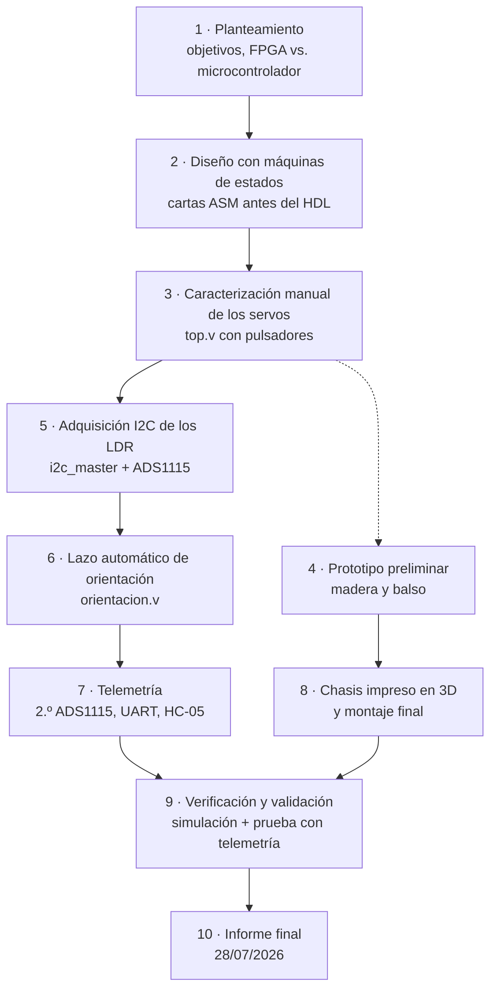

# Bitácora de progreso

Evolución del proyecto reconstruida a partir del [informe final](informe/Informe_Final_Solar_Tracker.pdf).

> **Sobre las fechas:** la única fecha que aparece en el informe es la de entrega del informe final,
> **28 de julio de 2026**. El orden de las etapas sale de lo que dice el propio informe ("antes de
> cerrar el lazo…", "etapa previa", "antes de fabricar la estructura definitiva…", "se ajustaron
> durante la depuración…"). No se han inventado fechas intermedias. Los commits de este repositorio
> tienen la fecha en que se publicó la documentación, no la de cada etapa.

## Resumen de etapas

*Las etapas 4 y 8 (mecánica) avanzaron en paralelo con las de lógica; el informe no indica su
orden exacto respecto a las etapas 5–7.*

## Detalle

### Etapa 1 — Planteamiento

- Problema: un panel fijo pierde irradiancia efectiva según $G_{ef} = G_{dir} \cos\theta_i$.
- Decisión: implementar todo en una FPGA Cyclone IV EP4CE6 en vez de un microcontrolador, para
  construir explícitamente el maestro I2C, el generador de baudios y los PWM, y aprovechar la
  concurrencia real del hardware.
- Seis objetivos específicos: arreglo de LDR, maestro I2C, PWM, UART, verificación por simulación y
  validación experimental con telemetría (ver [README](../README.md#objetivos)).

### Etapa 2 — Diseño con máquinas de estados

Los cuatro bloques (maestros I2C, controlador de orientación, PWM y UART) se concibieron como
máquinas de estados documentadas con cartas ASM **antes de escribir HDL**, y cada bloque se verificó
en simulación antes de la síntesis.

### Etapa 3 — Caracterización manual de los servos

- `top.v` de caracterización: `control_dos_servos` + dos `pwm_servo`, movidos con los pulsadores.
- Objetivo: medir los anchos de pulso de los extremos mecánicos reales, que no coinciden con la hoja
  de datos.
- Resultado: límites usados de **50 150** y **99 850** ciclos (0.5° y 179.5°), que luego usó el lazo
  automático.
- Evidencia: [Figura 5](img/fig05_rtl_caracterizacion_manual.png).

### Etapa 4 — Prototipo preliminar

- Base de madera y baldas de balso, con panel, tabique en cruz sobre los LDR y dos servos.
- Validó que el sombreado diferencial da una señal de error utilizable.
- Correcciones que pasaron al diseño final: **tabique más alto** (daba poca sombra con el sol cerca
  del cenit) y **estructura más rígida** (el balso se deformaba con el par de los servos).
- Evidencia: [Figura 8](img/fig08_prototipo_preliminar.jpg).

### Etapa 5 — Adquisición I2C de los LDR

- Maestro `i2c_master.v` a 100 kHz con SCL de cuatro fases y líneas open-drain.
- Escáner de cuatro canales en `orientacion.v`.
- Evidencia: [Figura 4](img/fig04_fsm_maestro_i2c.png).

### Etapa 6 — Lazo automático de orientación

- Lectura diferencial, tolerancias adaptativas por eje, histéresis direccional, pasos de 250 ciclos
  cada 20 ms e indicación por LED.
- Temporizador de arranque de 2 s con los servos centrados.

### Etapa 7 — Telemetría

- Segundo ADS1115 en un **bus I2C separado** (los dos tienen la dirección 0x48).
- `ads1115_reader`, `bin_to_ascii` (double dabble), `uart_tx` (8N1, 9 600 baudios, estados en código
  Gray) y `top_telemetry` (envío cada 500 ms).
- Reset de arranque de 1.31 ms en el `top.v` final.
- Evidencia: [Figura 3](img/fig03_rtl_top_level.png).

### Etapa 8 — Chasis impreso en 3D y montaje final

- Estructura tipo pedestal en PLA con base cónica, alojamientos para los servos y tabiques integrados.
- Montaje con la tarjeta Core EP4CE6 y la protoboard con el ADS1115, el HC-05 y las resistencias.
- Evidencia: [Figura 2](img/fig02_laminado_chasis_3d.png), [Figura 7](img/fig07_esquematico_conexion.png),
  [Figura 9](img/fig09_montaje_final.jpg).

### Etapa 9 — Verificación y validación

- Simulación con `top_tb.v`: los 8 parámetros de la Tabla 7 resultaron correctos.
- Prueba integrada: la tensión mostrada en la tablet sube al alinear y baja al desalinear.
- Evidencia: [Figura 10](img/fig10_sistema_funcionando_telemetria.jpg),
  [resultados.md](resultados.md).

### Etapa 10 — Informe final

Informe final entregado el **28 de julio de 2026** (26 páginas).

## Problemas encontrados y cómo se resolvieron

| Problema | Causa | Solución |
|----------|-------|----------|
| Pulso espurio de SCL al final de cada byte; el ADS1115 perdía la sincronización. | El bus soltaba SCL entre comandos de una misma transacción. | Bandera `hold_low` que mantiene SCL en bajo entre comandos. |
| Lecturas inestables en AIN2 y AIN3. | Retardos de conversión insuficientes. | Retardos de 30 ms en `S_INIT` y `S_WAIT_CONV`. |
| Primera lectura errática tras configurar la FPGA. | Pull-ups y ADS1115 aún sin estabilizar. | Reset de arranque de 2¹⁶ ciclos (1.31 ms). |
| Movimiento errático de los servos al encender. | Primeras lecturas del ADC aún inestables. | Temporizador de arranque de 2 s con servos centrados. |
| Oscilación permanente al sol directo con umbral fijo. | Respuesta no lineal de los LDR. | Tolerancias que crecen con la iluminación global. |
| *Hunting* alrededor del equilibrio. | Inversión de sentido con desbalances pequeños. | Histéresis direccional (1.25 · TOL para invertir). |
| Dos ADS1115 con la misma dirección 0x48. | Pin `ADDR` a masa en ambos. | Dos buses I2C físicamente separados. |
| Poca sombra cerca del cenit; estructura que se deformaba. | Tabique bajo y balso poco rígido (prototipo). | Tabique más alto y chasis impreso en 3D. |

## Pendiente en este repositorio

- [ ] Subir el código Verilog a `src/rtl/` y `src/caracterizacion/`.
- [ ] Subir `top_tb.v` y `slave_model_inc.v` a `sim/`.
- [ ] Subir `top.qsf` y `top.sdc` a `constraints/`.
- [ ] (Opcional) Subir los modelos CAD/STL del chasis a `hardware/`.
