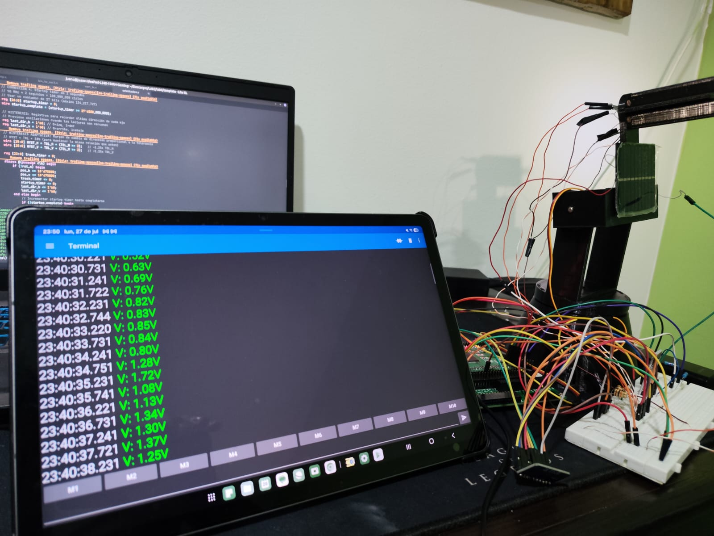

# Pruebas y resultados

Resumen de las secciones 5 y 6 del [informe final](informe/Informe_Final_Solar_Tracker.pdf).

## Verificación por simulación

Antes de configurar la FPGA, el diseño completo se verificó con `top_tb.v`, que instancia dos modelos
de esclavo ADS1115 (uno por bus) y decodifica la línea serial para imprimir en consola la cadena
transmitida.

| Parámetro | Valor esperado | Resultado |
|-----------|----------------|-----------|
| Frecuencia de SCL | 100 kHz | Correcto |
| Reconocimiento (ACK) del ADS1115 | Nivel bajo en el bit 9 | Correcto |
| Periodo de la señal PWM | 20 ms | Correcto |
| Rango del ancho de pulso | 1.0 ms a 2.0 ms | Correcto |
| Velocidad de la UART | 9 600 bps (+0.0064 %) | Correcto |
| Longitud de la trama | 10 caracteres ASCII | Correcto |
| Periodo de refresco de telemetría | 500 ms | Correcto |
| Convivencia de los dos buses | Sin interferencia mutua | Correcto |

## Prueba del sistema en funcionamiento

*Figura 10 — la tablet, enlazada por Bluetooth al HC-05, muestra la tensión del panel
actualizada cada 500 ms.*

Partiendo de una posición desalineada, la lectura en pantalla **sube** mientras los servos corrigen la
orientación y se estabiliza en su máximo cuando el error entra en la banda de tolerancia. Al
desalinear el panel a mano, la cifra **cae** de inmediato. Así se demuestra la relación entre
orientación y tensión generada sin instrumentación adicional.

## Comportamiento observado

- Ante el desplazamiento de una fuente luminosa, el sistema orienta ambos ejes en el sentido correcto
  hasta alinear el panel con la fuente.
- En equilibrio, las tolerancias adaptativas y la histéresis direccional evitan la oscilación
  permanente.
- Los dos ejes funcionan de forma independiente y simultánea; la telemetría no perturba la
  temporización de los pulsos de servo.
- El temporizador de arranque de 2 s elimina el movimiento errático inicial que se observaba antes de
  incorporarlo.
- El enlace Bluetooth se mantuvo estable durante las pruebas, sin pérdida apreciable de tramas.

## Alcance y limitaciones

- **No se registró una jornada completa.** No hay curva horaria de panel fijo frente a panel con
  seguimiento; lo demostrado, de forma directa y repetible, es que la tensión aumenta al alinear y
  disminuye al desalinear.
- **Se mide tensión, no potencia.** La tensión de circuito abierto varía de forma logarítmica con la
  irradiancia y satura rápido; cuantificar la ganancia energética exige medir V × I bajo carga y
  descontar el consumo de los servos.

## Conclusiones

1. **La lectura diferencial de los cuatro LDR orienta correctamente el panel en los dos ejes.** La
   resolución de 16 bits del ADS1115 fue determinante, y las tolerancias adaptativas con histéresis
   resolvieron el compromiso entre sensibilidad y estabilidad.
2. **La telemetría mostró que el seguimiento aprovecha mejor la luz disponible.** No se reporta una
   cifra de mejora porcentual; queda pendiente una medición bajo carga a lo largo del día.
3. **El diseño basado en máquinas de estados fue acertado.** Los problemas que aparecieron (pulso
   espurio de SCL, inestabilidad de AIN2/AIN3, movimiento errático al arrancar) fueron temporales o de
   protocolo, no errores de lógica.
4. **El paralelismo de la FPGA aportó una ventaja concreta:** dos buses I2C, dos PWM y un transmisor
   serial funcionan a la vez sin ningún arbitraje.

## Trabajo futuro

- Registrar la tensión del panel durante una jornada completa, fijo y con seguimiento, para
  cuantificar la mejora.
- Medir corriente bajo carga y evaluar la potencia real, descontando el consumo de los servos.
- Sustituir los incrementos fijos con histéresis por un controlador proporcional.
- Añadir un modo de bajo consumo que suspenda el seguimiento con poca luz.
