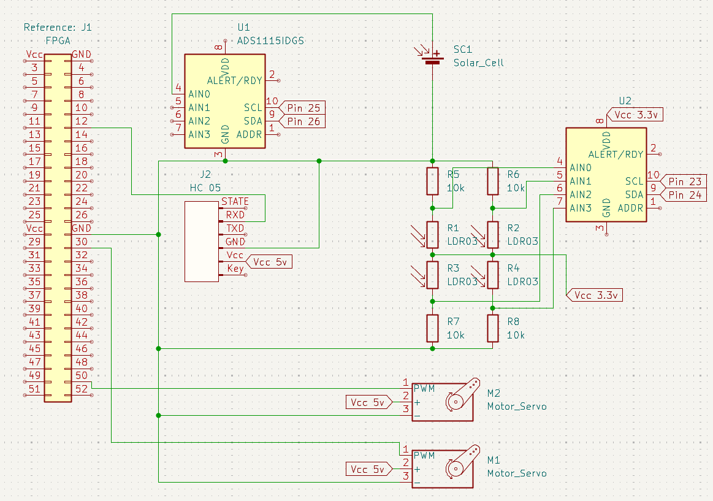
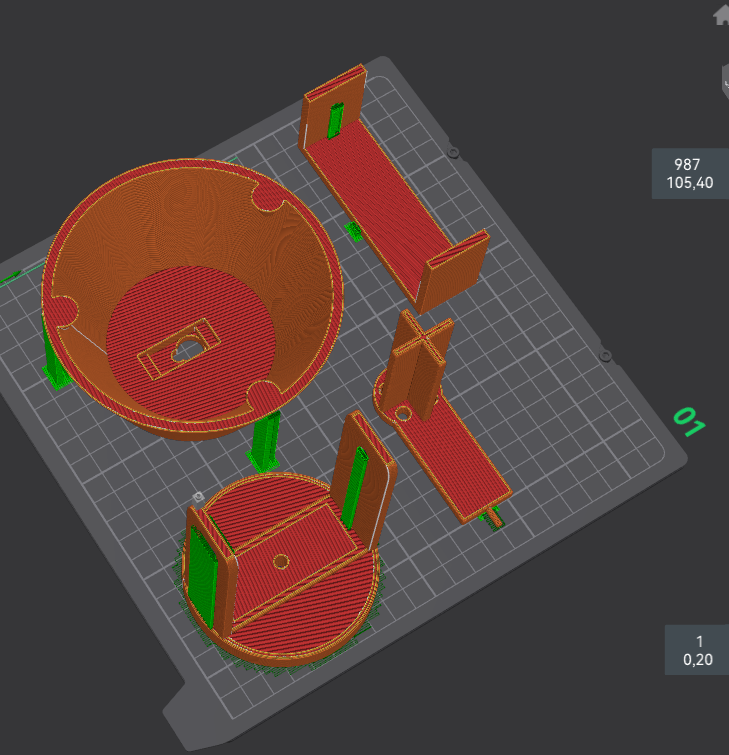
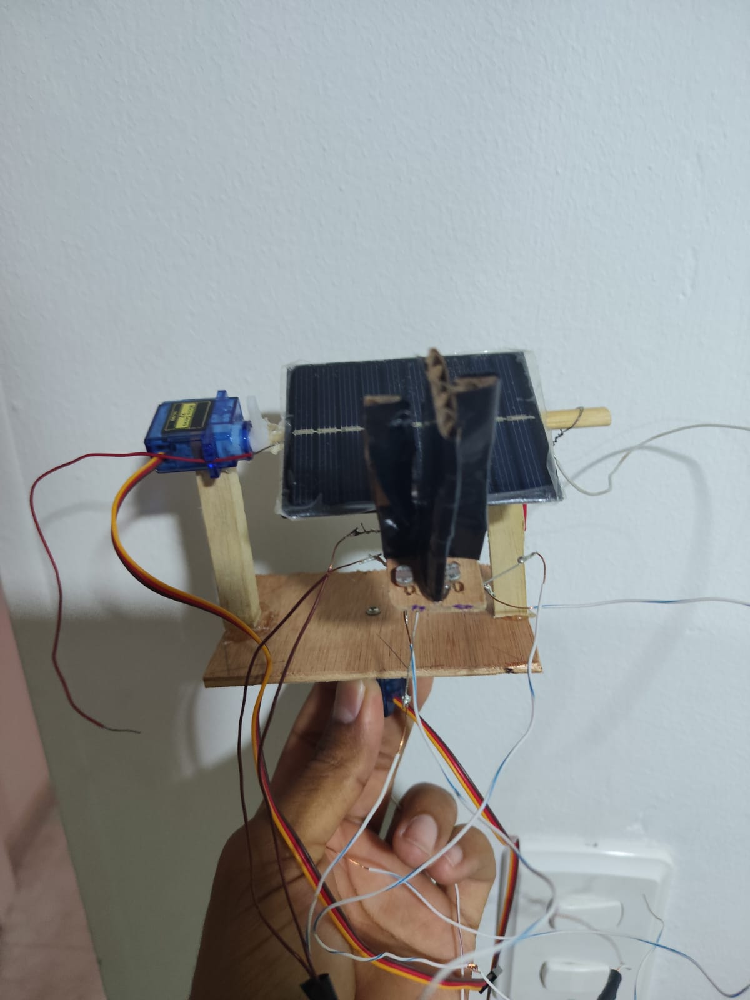
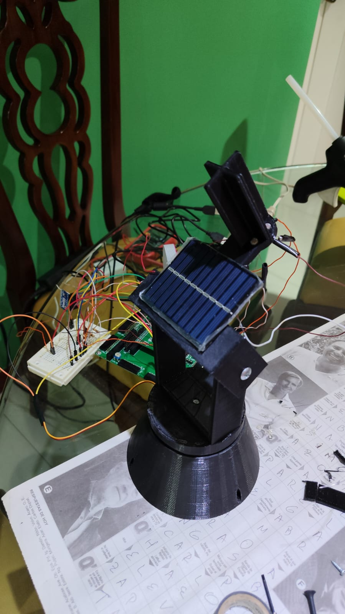

# Hardware

## Materiales

Componentes mencionados en el informe:

| Componente | Cantidad | Uso |
|------------|----------|-----|
| Tarjeta Core con FPGA Intel/Altera Cyclone IV EP4CE6 (oscilador de 50 MHz) | 1 | Procesamiento de todo el sistema. |
| ADC ADS1115 (16 bits, 4 canales, PGA, I2C) | 2 | Orientación (4 LDR) y telemetría (tensión del panel). |
| Fotorresistencia (LDR) | 4 | Arreglo en cruz con tabiques de sombreado. |
| Resistencia fija para el divisor de cada LDR | 4 | Acondicionamiento de cada LDR. |
| Resistencias 10 kΩ / 10 kΩ | 2 | Divisor de la tensión del panel (k = 1/2). |
| Resistencias de pull-up 4.7 kΩ a 3.3 V | — | Líneas SDA y SCL de los buses I2C. |
| Servomotor de posición | 2 | Ejes de azimut (base) y elevación (cabeza). |
| Módulo Bluetooth HC-05 | 1 | Enlace serial (SPP) hacia el celular. |
| Panel fotovoltaico pequeño | 1 | Superficie captadora cuya tensión se mide. |
| Chasis impreso en 3D (PLA) | 1 | Base-pedestal, plataforma de azimut, yugo de elevación y soportes. |

## Esquemático

*Figura 7 del informe — esquemático de la conexión física del proyecto.*

## Asignación de pines

Tal como se declara en `top.qsf` (todos los puertos en 3.3-V LVTTL):

| Señal | Dirección | Pin | Elemento externo |
|-------|-----------|-----|------------------|
| `clk` | Entrada | `PIN_23` | Oscilador de 50 MHz |
| `leds[0]` | Salida | `PIN_3` | LED: más luz a la izquierda |
| `leds[1]` | Salida | `PIN_7` | LED: más luz a la derecha |
| `leds[2]` | Salida | `PIN_10` | LED: más luz arriba |
| `leds[3]` | Salida | `PIN_11` | LED: más luz abajo |
| `scl` | Bidireccional | `PIN_54` | ADS1115 de orientación (reloj) |
| `sda` | Bidireccional | `PIN_55` | ADS1115 de orientación (datos) |
| `pwm_servo1` | Salida | `PIN_59` | Servomotor horizontal (base) |
| `pwm_servo2` | Salida | `PIN_60` | Servomotor vertical (cabeza) |
| `scl_tel` | Bidireccional | `PIN_51` | ADS1115 de telemetría (reloj) |
| `sda_tel` | Bidireccional | `PIN_52` | ADS1115 de telemetría (datos) |
| `uart_txd` | Salida | `PIN_64` | HC-05, pin RXD |

No hay pin de reset externo: `rst_n` se genera internamente con el contador de arranque. Los pines
no usados se reservan como entradas en alta impedancia.

## Diseño mecánico

Estructura tipo pedestal diseñada en CAD e impresa en 3D en PLA: una base circular aloja el servo de
azimut y encima va un yugo en U que soporta el eje de elevación.

*Figura 2 del informe — base-pedestal, plataforma de azimut, yugo de elevación y soportes del
arreglo de sensores en el software de laminado.*

Decisiones de diseño:

- **Base cónica de amplio diámetro:** el centro de masa se desplaza al inclinar el panel; la base
  ancha evita el vuelco sin contrapesos.
- **Alojamiento integrado para los servos:** cavidades con tolerancia ajustada, sin adhesivos y con
  menos juego mecánico.
- **Tabiques para los LDR integrados en la pieza:** garantizan la simetría entre los cuatro sensores.

## Prototipo preliminar y montaje final

| Prototipo preliminar (madera y balso) | Montaje final (chasis impreso en 3D) |
|:---:|:---:|
|  |  |
| *Figura 8* | *Figura 9* |

El prototipo preliminar sirvió para comprobar que el sombreado diferencial producía una señal de
error utilizable y para fijar la separación y altura de los tabiques. De él salieron dos correcciones
para el diseño final: el tabique era demasiado bajo para dar sombra con el sol cerca del cenit, y el
balso no era lo bastante rígido para el par de los servos.
